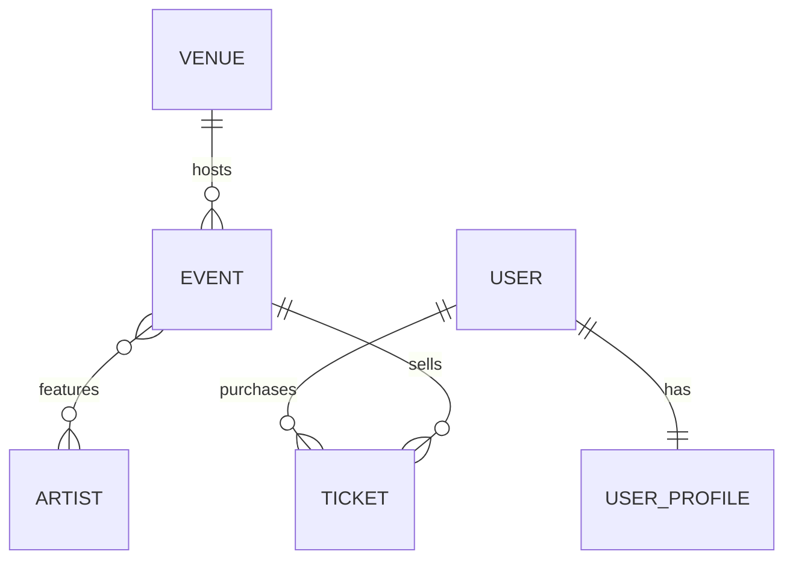

# PulsePass

Plataforma de eventos, artistas y entradas — caso de estudio académico de persistencia con **Java 21 / Spring Boot 4 / Spring Data JPA / PostgreSQL / Flyway / Testcontainers**.

El repositorio incluye el **backend** (raíz) y, desde la Fase 5, el **frontend** web en [`frontend/`](#11-frontend-fase-5--react--typescript--tailwind) (React 19 + TypeScript + Vite + Tailwind 4).

Este README responde a la sección 21 (Definition of Done) y sección 22 (Matriz de trazabilidad) del PRD.

## Integrantes

- Jeremias Esteban Parra Florez
- Aluna Soffia Perea Labastidas

---

## 1. Modelo de datos



| Entidad       | Atributos principales                                                                            |
|---------------|---------------------------------------------------------------------------------------------------|
| `Venue`       | id, code, name, city, address, capacity, active                                                   |
| `Event`       | id, eventCode, name, description, category, status, eventDate, minimumAge, streamingUrl, venue    |
| `Artist`      | id, stageName, country, genre, active                                                             |
| `User`        | id, username, email, active                                                                       |
| `UserProfile` | id, firstName, lastName, phone, city, birthDate, user                                             |
| `Ticket`      | id, ticketCode, type, price, status, purchaseDate, user, event                                    |

**Tablas:** `venues`, `events`, `artists`, `event_artists` (asociativa N:M), `users`, `user_profiles`, `tickets`.

### 1.1 Relaciones

| Relación                 | Tipo | Dueño de la relación (`@JoinColumn` / `@JoinTable`) |
|---------------------------|------|------------------------------------------------------|
| `Venue` → `Event`         | 1:N  | `Event` (FK `venue_id`, `NOT NULL`)                   |
| `Event` ↔ `Artist`        | N:M  | `Event` (`@JoinTable event_artists`), `Artist` usa `mappedBy` |
| `User` ↔ `UserProfile`    | 1:1  | `UserProfile` (FK `user_id`, `UNIQUE` + `NOT NULL`)   |
| `User` → `Ticket`         | 1:N  | `Ticket` (FK `user_id`, `NOT NULL`)                   |
| `Event` → `Ticket`        | 1:N  | `Ticket` (FK `event_id`, `NOT NULL`)                  |

**¿Por qué `Ticket` es una entidad y no un simple `@ManyToMany` entre `User` y `Event`?**
Porque un ticket tiene atributos propios de negocio que no le pertenecen ni a `User` ni a `Event` (`ticketCode`, `type`, `price`, `status`, `purchaseDate`), y porque un mismo usuario puede comprar varios tickets para el mismo evento (VIP + GENERAL, por ejemplo) — algo que una tabla intermedia N:M pura no puede representar, ya que su clave sería el par `(user_id, event_id)` y no permitiría duplicados. `Ticket` es la entidad de negocio central del dominio (BR-006).

### 1.2 Enums

Todos se persisten con `@Enumerated(EnumType.STRING)` (BR-008), nunca por ordinal. Además, `V1__create_schema.sql` los refuerza en PostgreSQL con un `CHECK ... IN (...)` por columna (FR-EVT-003, FR-EVT-004, FR-TKT-004, FR-TKT-005, NFR-001), de modo que la base rechaza valores fuera del catálogo aunque el `INSERT` no venga de Java.

| Enum            | Valores                                                        |
|------------------|-----------------------------------------------------------------|
| `EventCategory` | `MUSIC`, `SPORTS`, `TECHNOLOGY`, `EDUCATION`, `CULTURE`, `ENTERTAINMENT` |
| `EventStatus`   | `DRAFT`, `PUBLISHED`, `SOLD_OUT`, `CANCELLED`, `FINISHED`        |
| `TicketType`    | `GENERAL`, `VIP`, `BACKSTAGE`, `STUDENT`                         |
| `TicketStatus`  | `RESERVED`, `PAID`, `CANCELLED`, `USED`                          |

### 1.3 Integridad de datos (sección 8 del PRD)

| Campo / relación       | Restricción                                  |
|-------------------------|-----------------------------------------------|
| `venues.code`           | `UNIQUE`, `NOT NULL`                          |
| `venues.capacity`       | `CHECK (capacity > 0)`                        |
| `events.event_code`     | `UNIQUE`, `NOT NULL`                          |
| `artists.stage_name`    | `UNIQUE`, `NOT NULL`                          |
| `users.username`        | `UNIQUE`, `NOT NULL`                          |
| `users.email`           | `UNIQUE`, `NOT NULL`                          |
| `user_profiles.user_id` | `FK` + `UNIQUE` (fuerza la relación 1:1)      |
| `tickets.ticket_code`   | `UNIQUE`, `NOT NULL`                          |
| `tickets.price`         | `CHECK (price >= 0)`                          |
| `tickets.user_id` / `event_id` | `FK`, `NOT NULL`                       |
| `events.category`       | `CHECK` con los valores de `EventCategory`    |
| `events.status`         | `CHECK` con los valores de `EventStatus`      |
| `tickets.type`          | `CHECK` con los valores de `TicketType`       |
| `tickets.status`        | `CHECK` con los valores de `TicketStatus`     |
| `event_artists`         | `PK` compuesta `(event_id, artist_id)`        |

---

## 2. Migraciones (Flyway)

Ubicadas en `src/main/resources/db/migration/`.

| Migración                              | Contenido                                                                 |
|-----------------------------------------|----------------------------------------------------------------------------|
| `V1__create_schema.sql`                | Crea las 7 tablas con sus constraints (`UNIQUE`, `CHECK` de rangos y de catálogos de enums), FKs e índices. |
| `V2__insert_initial_artists.sql`       | Inserta el catálogo inicial: Solar Beat, Neon Waves, Caribbean Sound, Ocean Drive, Digital Pulse. |
| `V3__add_streaming_url_to_event.sql`   | Agrega `streaming_url VARCHAR(500)` nullable a `events`, sin modificar V1 (FR-EVT-006, evolución de esquema). |

Hibernate corre en modo `spring.jpa.hibernate.ddl-auto=validate`: **nunca crea ni modifica el esquema**, solo valida que las entidades JPA coincidan con lo que Flyway ya construyó. Si una entidad no coincide con las tablas, la aplicación falla al arrancar.

---

## 3. Repositories y consultas

Clasificación de cada consulta implementada (heredado de `JpaRepository` / Query Method / JPQL):

### `VenueRepository`
| Consulta | Tipo | Cubre |
|---|---|---|
| `findByCode(String)` | Query Method | FR-VEN-001 |

### `EventRepository`
| Consulta | Tipo | Cubre |
|---|---|---|
| `findByEventCode(String)` | Query Method | FR-EVT-002 |
| `findByStatusOrderByEventDateAsc(EventStatus)` | Query Method | FR-EVT-005 |
| `findByVenueCode(String)` | Query Method navegado | FR-VEN-004 |
| `findByArtistStageName(String)` | JPQL (`JOIN` + `DISTINCT`) | FR-SRC-001 / FR-ART-004 |
| `findByCityAndArtistStageName(String, String)` | JPQL (dos asociaciones) | FR-SRC-002 |
| `findRecommendedEvents(LocalDate, String, String)` | JPQL (case-insensitive, `LIKE`, `DISTINCT`, `ORDER BY`) | FR-SRC-003 |

### `ArtistRepository`
| Consulta | Tipo | Cubre |
|---|---|---|
| `findByStageName(String)` | Query Method | FR-ART-002 |

### `UserRepository`
| Consulta | Tipo | Cubre |
|---|---|---|
| `findByEmailIgnoreCase(String)` | Query Method | Sección 14 |

### `UserProfileRepository`
Solo hereda de `JpaRepository`; se accede a `UserProfile` vía `User.getProfile()`.

### `TicketRepository`
| Consulta | Tipo | Cubre |
|---|---|---|
| `findByUserEmail(String)` | Query Method navegado | FR-TKT-006 |
| `findByUserEmailAndStatus(String, TicketStatus)` | Query Method navegado | FR-TKT-006 |
| `findByEventEventCodeAndStatus(String, TicketStatus)` | Query Method navegado | FR-TKT-007 |
| `countPaidTicketsByEventCode(String)` | JPQL (`COUNT`) | FR-TKT-008 |
| `findByEventEventDateAfterOrderByEventEventDateAsc(LocalDate)` | Query Method navegado | FR-SRC-004 (Could) |

**Sobre FR-TKT-007** (pregunta 3, sección 23): se eligió **Query Method** en vez de JPQL porque es un filtro de igualdad simple sobre dos propiedades navegadas (`event.eventCode`, `status`), sin agregaciones ni múltiples joins — el nombre del método ya es autoexplicativo. Esto contrasta con FR-SRC-002, que cruza dos asociaciones distintas (`venue` y `artists`) y por eso sí requiere JPQL explícito.

---

## 4. Cómo ejecutar el proyecto

Requisitos: Java 21, Maven (o el wrapper `mvnw` incluido), Docker Desktop corriendo (para Testcontainers).

```bash
# Compilar
./mvnw clean compile

# Correr la aplicación (requiere PostgreSQL local en application.properties)
./mvnw spring-boot:run
```

**Nota:** si ya habías ejecutado la aplicación contra una base local `pulsepass` con una versión anterior de `V1__create_schema.sql`, Flyway detectará que el checksum cambió y fallará al arrancar. En ese caso borra y recrea la base local (o usa `flyway repair`). Las pruebas no se ven afectadas, porque Testcontainers crea una base nueva en cada ejecución.

## 5. Cómo correr las pruebas

Las pruebas de integración (`PersistenceIntegrationTest`) usan **Testcontainers**: levantan un contenedor real de PostgreSQL (`postgres:16-alpine`), corren las migraciones de Flyway desde cero, y ejecutan todos los repositories y consultas contra esa base — no contra H2 ni ningún mock.

```bash
./mvnw clean test
```

**Requisito:** Docker Desktop debe estar corriendo. La primera ejecución descarga la imagen `postgres:16-alpine` (~110 MB); las siguientes son instantáneas porque la imagen queda cacheada localmente.

Resultado esperado: `BUILD SUCCESS` (QT-010) con todos los tests en verde:

- **Persistencia (Fase 1):** 35 tests — 34 en `PersistenceIntegrationTest` más `contextLoads` en `PulsepassApplicationTests`.
- **Service (Fase 2):** los tests de las implementaciones de `service/impl`.
- **Controller (Fase 3):** 58 tests `@WebMvcTest` + MockMvc (no necesitan Docker; ver sección 9).

### Cobertura de pruebas

| Criterio | Qué verifica |
|---|---|
| QT-001 | Flyway aplica V1, V2 y V3 desde una base vacía; catálogo de artistas cargado |
| QT-002 | Hibernate valida el esquema (no lo crea/actualiza) |
| QT-003 | Relación `Venue` 1:N `Event` |
| QT-004 | Relación `User` 1:1 `UserProfile` |
| QT-005 | Relación `Event` N:M `Artist`; agregar dos veces el mismo artista no duplica la asociación (nivel Java, gracias al `Set`) |
| QT-006 | `Ticket → User` y `Ticket → Event`; enums persistidos como texto |
| QT-007 | Query Methods simples y navegados |
| QT-008 | JPQL con `JOIN` y `COUNT`; el `DISTINCT` se comprueba con un artista parcial (`"a"`) que coincide con los tres artistas de un mismo evento y aun así lo devuelve una sola vez |
| QT-009 | Restricciones `UNIQUE` reales (`saveAndFlush` + `DataIntegrityViolationException`) y la PK compuesta de `event_artists`, que rechaza en PostgreSQL un par evento-artista duplicado |
| NFR-001 | `CHECK` reales en PostgreSQL: `capacity > 0`, `price >= 0` y `status` de evento fuera del catálogo |
| QT-010 | `mvn clean test` termina en `BUILD SUCCESS` |

Los 8 criterios de aceptación funcionales (AC-001 a AC-008) de la sección 11 del PRD están cubiertos dentro de los tests anteriores (ver `@DisplayName` de cada test en `PersistenceIntegrationTest.java` para el mapeo exacto).

**Nota sobre SQL nativo:** unos pocos tests usan SQL nativo solo para verificar el estado real de la base (`flyway_schema_history`, filas de `event_artists`, texto de los enums, un `INSERT` con un estado inválido y un `INSERT` de un par duplicado en `event_artists`). Ninguna consulta de los requisitos del taller (sección 4 del PRD) usa SQL nativo: todas son heredadas, Query Methods o JPQL.

---

## 6. Matriz de trazabilidad (sección 22 del PRD)

| Requisito     | Dominio                  | Repository                          | Test |
|----------------|----------------------------|----------------------------------------|------|
| `FR-VEN-*`     | Venue                     | `VenueRepository`                      | `PersistenceIntegrationTest` |
| `FR-EVT-*`     | Event + Venue             | `EventRepository`                      | `PersistenceIntegrationTest` |
| `FR-ART-*`     | Event + Artist            | `EventRepository` / `ArtistRepository` | `PersistenceIntegrationTest` |
| `FR-USR-*`     | User + UserProfile        | `UserRepository`                       | `PersistenceIntegrationTest` |
| `FR-TKT-*`     | Ticket + User + Event     | `TicketRepository`                     | `PersistenceIntegrationTest` |
| `FR-SRC-*`     | Event / Artist / Venue    | `EventRepository`                      | `PersistenceIntegrationTest` |
| `NFR-002/003`  | Flyway                    | N/A                                     | `PersistenceIntegrationTest` |
| `NFR-004/005`  | Testcontainers            | N/A                                     | `PersistenceIntegrationTest` |

---

## 7. Preguntas para el equipo (sección 23 del PRD)

1. **¿Por qué `Ticket` debe ser una entidad en lugar de un `@ManyToMany` entre `User` y `Event`?**
   Porque tiene atributos propios (`ticketCode`, `type`, `price`, `status`, `purchaseDate`) que no pertenecen a ninguna de las dos entidades relacionadas, y porque un usuario puede comprar más de un ticket para el mismo evento — algo que una tabla intermedia N:M pura no permite representar sin violar su propia clave compuesta.

2. **¿Qué reglas pertenecen a PostgreSQL y cuáles deberían quedar para una futura capa Service?**
   A PostgreSQL le corresponden las reglas de **integridad estructural**: unicidad, no-nulidad, claves foráneas, rangos válidos y catálogos cerrados de valores (`CHECK`, incluidos los estados, categorías y tipos de los enums) — cosas que deben cumplirse siempre, sin excepción, sin importar qué aplicación escriba en la base. A una capa Service futura le correspondería la **lógica de negocio dinámica**: por ejemplo, impedir la venta de tickets si el evento está `SOLD_OUT`, calcular descuentos, o validar reglas que cambian con el tiempo y no deberían obligar a una migración de esquema cada vez que cambian.

3. **¿Qué consultas pueden expresarse claramente como Query Methods y cuáles justifican JPQL?**
   Un Query Method es apropiado cuando la consulta es un filtro de igualdad/comparación simple sobre una o dos propiedades navegadas, y el nombre del método ya explica qué hace (ej. `findByEventEventCodeAndStatus`). JPQL se justifica cuando hace falta `DISTINCT` para evitar duplicados de un `JOIN` a una relación N:M, cuando se cruzan varias asociaciones distintas en la misma condición (ej. `venue.city` + `artists.stageName`), o cuando se necesita una función de agregación como `COUNT`.

4. **¿Qué consecuencias tendría modificar V1 después de haberla aplicado en un ambiente compartido?**
   Flyway calcula un checksum de cada migración aplicada. Si se modifica `V1__create_schema.sql` después de que ya corrió en cualquier ambiente compartido, Flyway detectará el checksum distinto y **rechazará** ejecutar más migraciones en ese ambiente hasta que se repare manualmente el historial (`flyway repair`) o se revierta el cambio — puede dejar el pipeline de CI/CD roto para todo el equipo. Por eso los cambios de esquema posteriores deben ir siempre en una migración nueva (como se hizo con V3), nunca editando una ya aplicada.
   En este proyecto, V1 solo tuvo una versión: nunca fue aplicada por Flyway (ni en local ni en Testcontainers) antes de llegar a su forma final, por lo que no existió ningún checksum previo que pudiera romperse. La distinción que sí es real y aplica hacia adelante: si ahora quisiéramos agregar, por ejemplo, otro `CHECK` a `venues`, la forma correcta sería una migración nueva (`V4__...sql`), nunca editar `V1__create_schema.sql` directamente — precisamente para no reproducir el escenario de checksum roto que describe el párrafo anterior.

5. **¿Qué diferencias podría ocultar una prueba con H2 frente a PostgreSQL?**
   H2 no implementa el mismo dialecto SQL que PostgreSQL: puede aceptar sintaxis que Postgres rechaza (o viceversa), y sus mensajes de error ante violaciones de constraints son distintos. Más importante: H2 no siempre refuerza `CHECK` constraints, tipos de datos exactos (como `NUMERIC(10,2)`), ni el comportamiento real de índices y locks bajo concurrencia. Un test que pasa en H2 podría fallar silenciosamente en producción sobre PostgreSQL real — por eso este taller usa Testcontainers con PostgreSQL real en vez de una base en memoria.

6. **¿Cómo evolucionaría el modelo para soportar inventario de tickets y evitar sobreventa?**
   Se necesitaría una tabla de inventario por evento y tipo de ticket (ej. `event_ticket_inventory` con `event_id`, `ticket_type`, `total_capacity`, `sold_count`), con un `CHECK (sold_count <= total_capacity)`. La compra de un ticket tendría que incrementar `sold_count` de forma atómica (usando un `UPDATE ... WHERE sold_count < total_capacity` o un lock optimista con `@Version`) para evitar condiciones de carrera cuando dos usuarios compran el último cupo al mismo tiempo.

---

## 8. Stack técnico

- Java 21
- Spring Boot 4.1.1
- Spring Data JPA / Hibernate 7.4.5
- Spring MVC · Bean Validation · MockMvc
- PostgreSQL (driver 42.7.13)
- Flyway 12.4.0
- Testcontainers 2.0.5
- JUnit 5 / Spring Boot Test

---

## 9. API REST — Capa de Controladores (Fase 3)

Expone mediante HTTP los 20 métodos de Service. El Controller no contiene reglas de negocio,
no usa Repository y devuelve solo DTOs; todos los errores salen por `GlobalExceptionHandler`
con el contrato `ErrorResponse`.

### 9.1 Cómo ejecutar
```bash
./mvnw spring-boot:run          # requiere PostgreSQL local (ver application.properties)
```

### 9.2 Cómo correr las pruebas de Controller
```bash
./mvnw test -Dtest='*ControllerTest'   # @WebMvcTest + MockMvc, sin Docker ni BD
./mvnw clean test                      # build completo (requiere Docker por Testcontainers)
```

### 9.3 Endpoints principales

| Método | Endpoint | Descripción | Éxito |
|---|---|---|---|
| GET | `/api/venues/{code}` | Consultar venue | 200 |
| GET | `/api/venues/active` | Venues activos | 200 |
| POST | `/api/events` | Crear evento | 201 |
| GET | `/api/events/{eventCode}` | Consultar evento | 200 |
| GET | `/api/events/published` | Eventos publicados | 200 |
| PATCH | `/api/events/{eventCode}/publish` | Publicar evento | 200 |
| POST | `/api/events/{eventCode}/artists/{artistId}` | Asociar artista | 200 |
| GET | `/api/events/by-artist?stageName=` | Eventos por artista | 200 |
| GET | `/api/artists/{id}` | Artista por ID | 200 |
| GET | `/api/artists/by-stage-name?stageName=` | Artista por nombre artístico | 200 |
| GET | `/api/artists/active` | Artistas activos | 200 |
| POST | `/api/users` | Registrar usuario | 201 |
| GET | `/api/users/by-email?email=` | Usuario por email | 200 |
| GET | `/api/users/by-username?username=` | Usuario por username | 200 |
| POST | `/api/tickets` | Comprar ticket | 201 |
| GET | `/api/tickets/{ticketCode}` | Consultar ticket | 200 |
| GET | `/api/tickets/by-user?email=` | Tickets de un usuario | 200 |
| GET | `/api/events/{eventCode}/tickets/paid` | Tickets pagados de un evento | 200 |
| PATCH | `/api/tickets/{ticketCode}/cancel` | Cancelar ticket | 200 |
| PATCH | `/api/tickets/{ticketCode}/use` | Marcar ticket como usado | 200 |

### 9.4 Contrato de errores
```json
{
  "timestamp": "2026-10-04T20:00:00",
  "status": 404,
  "error": "Not Found",
  "message": "Event not found: CMF-2026",
  "details": {}
}
```

| Código | Cuándo | Excepción |
|---|---|---|
| 400 | Bean Validation, JSON mal formado, parámetro faltante o de tipo inválido | `MethodArgumentNotValidException`, `HttpMessageNotReadableException`, `MissingServletRequestParameterException`, `MethodArgumentTypeMismatchException` |
| 404 | Recurso inexistente | `ResourceNotFoundException` |
| 409 | Duplicado o regla de negocio | `DuplicateResourceException`, `BusinessRuleException` |
| 500 | Error inesperado (mensaje genérico, detalle solo en el log) | `Exception` |

### 9.5 Cobertura de pruebas (58 tests)
`VenueControllerTest` (4) · `EventControllerTest` (20) · `ArtistControllerTest` (6) ·
`UserControllerTest` (13) · `TicketControllerTest` (15). Cubren AC-CTRL001 a AC-CTRL014
(ver comentarios `// TEST-CTRL-… / AC-CTRL…` en cada test). AC-CTRL015 y AC-CTRL016 se
verifican por diseño: ningún Controller importa un Repository ni una entidad de `domain`.

## 10. Seguridad (Fase 4) — Spring Security + JJWT

La API es *stateless*: cada request protegido lleva `Authorization: Bearer <JWT>`. El JWT (HS256,
15 min) solo contiene `sub` (ID del usuario), `iss`, `iat`, `exp` y `jti`; el estado y los roles se
recargan desde la base de datos en **cada** request, por lo que un usuario desactivado o con rol
retirado pierde acceso de inmediato.

### 10.1 Variables de entorno

| Variable | Obligatoria | Descripción |
|---|---|---|
| `PULSEPASS_JWT_SECRET_BASE64` | **Sí** | Secreto HMAC en Base64 (≥ 32 bytes). Sin ella la app no arranca. |
| `PULSEPASS_JWT_ISSUER` | No | Emisor esperado (por defecto `pulsepass-api`). |
| `PULSEPASS_CORS_ORIGINS` | No | Orígenes CORS permitidos, separados por comas. Vacío = ninguno. |
| `PULSEPASS_BOOTSTRAP_ADMIN_PASSWORD` | Solo perfil `local` | Contraseña de la cuenta semilla `admin` (≥ 12 caracteres). |
| `PULSEPASS_BOOTSTRAP_STAFF_PASSWORD` | Solo perfil `local` | Contraseña de la cuenta semilla `laura` (≥ 12 caracteres). |

Generar el secreto: `openssl rand -base64 32` (en PowerShell, ver la guía de implementación).
Hay una plantilla sin secretos en `.env.example`; el archivo `.env` real está en `.gitignore`.

### 10.2 Roles y cuentas de prueba

| Rol | Cómo se obtiene | Cuenta de demo |
|---|---|---|
| `USER` | Registro público (`POST /api/users`); es el único rol posible por HTTP | `andrea`, `carlos`… |
| `STAFF` | Semilla local (`LocalAccountsSeeder`, perfil `local`) | `laura` |
| `ADMIN` | Semilla local (`LocalAccountsSeeder`, perfil `local`) | `admin` |

Los roles privilegiados **nunca** se asignan por HTTP. Los usuarios creados en las fases 1–3 no
tienen credencial y no pueden iniciar sesión hasta que se les active una de forma segura.

### 10.3 Endpoints nuevos y cambio de contrato

| Método | Endpoint | Acceso | Respuesta |
|---|---|---|---|
| POST | `/api/auth/login` | Público | 200 `{accessToken, tokenType: "Bearer", expiresIn: 900}`; 401 genérico si falla |
| GET | `/api/auth/me` | Bearer | 200 `{id, username, email, roles}` |

`POST /api/users` **cambia su contrato de entrada**: ahora exige `password` (12–72 caracteres/bytes).
La respuesta (`UserResponse`) sigue sin incluir contraseña ni hash, y el registro no devuelve token:
el flujo del MVP es *registro → login*.

### 10.4 Matriz de autorización de las 20 rutas

| Ruta | Acceso |
|---|---|
| `GET /api/venues/{code}`, `GET /api/venues/active` | Público |
| `GET /api/artists/{id}`, `/by-stage-name`, `/active` | Público |
| `GET /api/events/published` | Público |
| `GET /api/events/{eventCode}`, `GET /api/events/by-artist` | Público **solo eventos publicados** (borrador → 404); STAFF/ADMIN ven todos |
| `POST /api/events`, `PATCH /api/events/{eventCode}/publish`, `POST /api/events/{eventCode}/artists/{artistId}` | `ADMIN` |
| `POST /api/users` | Público (rol inicial siempre `USER`) |
| `GET /api/users/by-email`, `GET /api/users/by-username` | El propio usuario, o `ADMIN` |
| `POST /api/tickets` | `USER`, y `userEmail` debe ser el del usuario autenticado |
| `GET /api/tickets/{ticketCode}` | Propietario, o `STAFF`/`ADMIN` |
| `GET /api/tickets/by-user?email=` | El propio usuario, o `ADMIN` |
| `PATCH /api/tickets/{ticketCode}/cancel` | Propietario (`USER`), o `ADMIN` |
| `PATCH /api/tickets/{ticketCode}/use`, `GET /api/events/{eventCode}/tickets/paid` | `STAFF`/`ADMIN` |

Política de propiedad: un recurso ajeno (o un ticket inexistente) responde **403** de forma
uniforme, para no revelar qué códigos existen. `401` = sin identidad válida; `403` = identidad
válida sin permiso. Ambos usan el mismo `ErrorResponse` de seis campos.

### 10.5 Comandos

```bash
./mvnw clean verify                                   # unitarias + MockMvc + integración (requiere Docker)
./mvnw test -Dtest=SecurityMatrixTest                 # matriz de roles sobre las rutas, sin Docker
SPRING_PROFILES_ACTIVE=local ./mvnw spring-boot:run   # arranca con las cuentas semilla admin y laura
```

### 10.6 Limitaciones declaradas (no es un sistema listo para producción)

- Sin *refresh tokens*, sin logout con invalidación y sin revocación por `jti`: un token robado vale hasta que vence (15 min).
- Sin límite de intentos de login ni protección contra fuerza bruta.
- Clave HMAC simétrica sin rotación ni identificadores de clave.
- `STAFF` es global: el dominio aún no asigna personal a eventos concretos.
- `ADMIN` puede consultar usuarios y tickets ajenos sin registro de "propósito" auditado.
- HTTPS es obligatorio fuera de localhost; la app no lo impone por sí sola.
- CORS depende de `PULSEPASS_CORS_ORIGINS`; vacío significa ningún origen permitido.
- Los usuarios legados (fases 1–3) no tienen credencial y no pueden iniciar sesión.
- `application.properties` conserva las credenciales de la base de datos local de desarrollo (`postgres`/`postgres`); en cualquier otro entorno deben sobrescribirse con variables de entorno.

---

## 11. Frontend (Fase 5) — React + TypeScript + Tailwind

Aplicación web en `frontend/` que consume la API REST de las secciones 9 y 10. Implementa las 20 páginas
del PRD de frontend, con modo claro y oscuro, diseño responsive y control de acceso por rol.

### 11.1 Stack

| Área | Tecnología |
|---|---|
| Build y servidor de desarrollo | Vite 8 |
| UI | React 19 + TypeScript (modo estricto) |
| Estilos | Tailwind CSS 4 (tokens de marca en `@theme`, variantes `dark:`) |
| Enrutado | `react-router` 8 (`createBrowserRouter`, rutas con carga perezosa) |
| Datos del servidor | TanStack Query 5 |
| Formularios y validación | React Hook Form + zod 4 (las respuestas de la API también se validan con zod) |
| Pruebas | Vitest 5 + Testing Library + MSW 3 (la red se simula, no se usa el backend) |
| Calidad | oxlint (lint) y Prettier (formato) |

### 11.2 Cómo ejecutarlo

Requisitos: Node.js 20 o superior y el backend corriendo en `http://localhost:8080` (secciones 4 y 10).

```bash
cd frontend
cp .env.example .env     # opcional: VITE_API_BASE_URL=/api por defecto
npm install
npm run dev              # http://localhost:5173 (el proxy de Vite reenvía /api a :8080)
```

| Script | Qué hace |
|---|---|
| `npm run dev` | Servidor de desarrollo |
| `npm test` | Pruebas (84) |
| `npx tsc -b` | Revisión de tipos |
| `npm run lint` | oxlint, 0 advertencias |
| `npm run build` | Build de producción en `frontend/dist/` |
| `npm run format` | Prettier |

Si no se usa el proxy de Vite (URL absoluta en `VITE_API_BASE_URL`), el backend debe tener
`PULSEPASS_CORS_ORIGINS` con el origen del frontend.

**Cuentas de prueba:** `admin` (ADMIN) y `laura` (STAFF) las crea el backend con el perfil `local` (sección 10.1);
un USER se registra desde `/registro` (contraseña de 12 o más caracteres).

### 11.3 Datos de demostración

El backend solo trae artistas semilla (migración V2), así que para ver el catálogo se cargan dos scripts opcionales,
fuera de `db/migration` y pensados solo para una base local. Se copian al contenedor y se ejecutan con `psql`
(no usar `Get-Content | docker exec` en PowerShell 5.1: convierte las tildes en `?`):

```powershell
docker cp frontend/docs/seed-demo.sql pulsepass-db:/tmp/seed-demo.sql
docker cp frontend/docs/seed-eventos-extra.sql pulsepass-db:/tmp/seed-extra.sql
docker exec -e PGCLIENTENCODING=UTF8 pulsepass-db psql -U postgres -d pulsepass -f /tmp/seed-demo.sql
docker exec -e PGCLIENTENCODING=UTF8 pulsepass-db psql -U postgres -d pulsepass -f /tmp/seed-extra.sql
```

| Script | Contenido |
|---|---|
| `seed-demo.sql` | 2 sedes y 3 eventos (`CMF-2026`, `TECH-2027` y el borrador `DRAFT-001`) con artistas asociados |
| `seed-eventos-extra.sql` | 5 sedes más y 6 eventos (todas las categorías, más un borrador). Se puede ejecutar varias veces sin duplicar |

Las sedes son **reales** (Estadio Sierra Nevada, Movistar Arena, Teatro Metropolitano de Medellín, Teatro Municipal
Enrique Buenaventura, Coliseo El Pueblo, Teatro Adolfo Mejía y Centro de Convenciones de Cartagena) con su aforo
aproximado tomado de fuentes públicas; los eventos son ficticios. Para probar el estado «Agotado» se baja el aforo a mano,
por ejemplo `UPDATE venues SET capacity = 3 WHERE code = 'VEN-SMR-01';`.

### 11.4 Cambios y decisiones fuera del PRD

Todo lo siguiente es **decisión propia del equipo**; el PRD de frontend no lo pide:

| Cambio | Dónde | Por qué |
|---|---|---|
| **Lista «Tickets por validar»** con campo de filtro por código o titular y botón **Seleccionar** | `/staff/validacion` (STAFF y ADMIN) | El PRD §9.14 solo define la búsqueda por código de ticket. La lista permite encontrar un ticket sin tener el código a mano, usando el endpoint existente `GET /api/events/{code}/tickets/paid`, sin cambios en el backend. «Seleccionar» carga el ticket en la tarjeta de búsqueda, donde se confirma con «Marcar como usado»: hay un solo camino de validación y no se marca un ingreso por un clic accidental. |
| **Botón «Copiar»** para el código de ticket y el de evento | Detalle y confirmación de ticket, validación de ingreso, tablas de tickets, detalle y gestión de evento, lista de eventos creados | Facilita pegar los códigos en la búsqueda, en «Tickets por validar» y en la gestión de eventos. Usa `navigator.clipboard` y, si no está disponible (p. ej. la app abierta por `http://IP` desde el celular), `execCommand('copy')`. |
| **Atajo con el código del evento** y enlaces «Ver tickets pagados →» / «Gestionar evento →» | Detalle de evento, para STAFF y ADMIN (la gestión, solo ADMIN) | La API no lista borradores ni eventos agotados (GAP-01 del PRD) y la pantalla de gestión se abre con el código; el código se muestra a quien lo necesita. |
| **Sedes y eventos de demostración reales** (`seed-demo.sql`, `seed-eventos-extra.sql`) | `frontend/docs/` | El backend no trae datos semilla de sedes ni eventos. |
| **oxlint en lugar de ESLint** | `npm run lint` | El PRD menciona ESLint. Se mantiene oxlint porque es el que trae la plantilla actual de Vite 8, es mucho más rápido y pasa con 0 advertencias. El código no depende de él: migrar a ESLint es instalar `eslint`, `typescript-eslint` y `eslint-plugin-react-hooks` y cambiar el script `lint`. |
| **El proxy de Vite quita la cabecera `Origin`** | `frontend/vite.config.ts` | Sin esto, las peticiones POST de desarrollo recibían 403 por CORS al pasar por el proxy. Solo afecta al servidor de desarrollo. |
| **Imágenes de diseño extraídas del PDF** del PRD | `frontend/docs/diseno/` | No se tenía la carpeta `imagenes/` original; se usan las figuras del PDF, numeradas, como referencia visual. |

### 11.5 Comportamientos y limitaciones conocidos

- **Un evento agotado no vuelve a publicarse al cancelar tickets.** Al venderse el último cupo, el backend pasa el evento a
  `SOLD_OUT` (BR-TICKET-008), pero `cancel` libera el cupo sin devolverlo a `PUBLISHED`; el catálogo público muestra solo `PUBLISHED`.
  Corregirlo es un cambio de backend, fuera del alcance del frontend (PRD §26).
- **No hay un listado de todos los eventos** (GAP-01): los campos «Código del evento» se escriben a mano. Un futuro
  `GET /api/events` (STAFF/ADMIN) permitiría reemplazarlos por un selector y listar borradores y agotados.
- **No existe «eliminar cuenta».** No hay endpoint ni pantalla, y `tickets.user_id` referencia a `users(id)` sin `ON DELETE`,
  por lo que la base rechaza borrar un usuario con tickets; los tickets se conservan como historial.
- Los guards de ruta del frontend son solo de experiencia de usuario; la autorización real la aplica el backend (sección 10.4).
- El token vive en memoria y en `sessionStorage`; al vencer (15 min) la siguiente petición lleva a `/login` con el aviso de sesión expirada.
